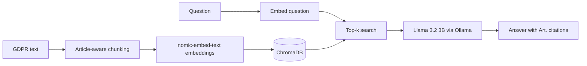

# ⚖️ GDPR Assistant: an offline RAG chatbot

Ask questions about the EU General Data Protection Regulation (GDPR) and get answers **with article citations**, running **100% on your own computer**. No cloud, no API keys, no data leaves your machine.

> ⚠️ Educational project. This is **not legal advice**.


## Features

- **Fully offline:** local LLM (Ollama) and local vector database (ChromaDB). Internet is only needed once, to download the models.
- **Cited answers:** every answer points to the source article, for example `[Art. 33]`.
- **Article-aware chunking:** the regulation is split by article (99 articles + recitals → 328 chunks), so citations stay accurate.
- **Direct article lookup:** if you type "Article 17", that article is fetched first.
- **Refuses out-of-scope questions:** answers "The provided GDPR text does not cover this." instead of making things up.
- **Clean Streamlit UI:** example questions, source chips, the retrieved text, and response time for every answer.
- **Evaluation harness:** 24 test questions with expected articles and key facts, plus a script that measures retrieval and answer quality.

## How it works



1. **Ingest:** `ingest.py` splits the text per article, embeds each chunk, and stores it in ChromaDB.
2. **Retrieve:** the question is embedded and the closest chunks are fetched.
3. **Generate:** a local LLM answers using only those chunks, at temperature 0, and must cite them.

## Tech stack

Python · [Ollama](https://ollama.com) (`llama3.2:3b`, `nomic-embed-text`) · [ChromaDB](https://www.trychroma.com) · [Streamlit](https://streamlit.io) · pypdf

## Quick start

**Requirements:** Python 3.10+, [Ollama](https://ollama.com), about 8 GB RAM. No GPU needed.

```bash
# 1. Get the code
git clone https://github.com/<your-username>/<your-repo>.git
cd <your-repo>

# 2. Download the local models (once, needs internet)
ollama pull llama3.2:3b
ollama pull nomic-embed-text

# 3. Python environment
python -m venv venv
venv\Scripts\activate            # Windows
# source venv/bin/activate       # macOS / Linux
pip install -r requirements.txt

# 4. Add the GDPR text (see below), then build the index
mkdir docs
python ingest.py

# 5. Run the chatbot
streamlit run app.py
```

### Getting the GDPR text

The regulation text is **not included** in this repository. Download it yourself from the official source:

1. Open <https://eur-lex.europa.eu/eli/reg/2016/679/oj/eng>
2. Select all text on the page, copy it, and paste it into `docs/gdpr.txt`. Save the file.
3. Each article must start on its own line, such as `Article 17`, followed by its title on the next line.

`ingest.py` should print `99 articles found`.

## Project structure

```
.
├── app.py                    # Streamlit chatbot
├── chunker.py                # article-aware chunking
├── ingest.py                 # builds the ChromaDB index from docs/
├── requirements.txt
├── evaluation/
│   ├── eval_questions.json   # 24 questions with expected articles and key facts
│   └── run_eval.py           # evaluation script
├── .streamlit/config.toml    # UI theme
├── assets/screenshot.png
└── docs/                     # put gdpr.txt here (not tracked)
```

## Evaluation

`evaluation/eval_questions.json` has 24 questions: 19 direct, 2 multi-article ("list all rights of a data subject"), and 3 out-of-scope traps. Expected articles and key facts were checked against the official text.

```bash
python evaluation/run_eval.py --mode retrieval              # fast: are the right articles retrieved?
python evaluation/run_eval.py --mode full --name plain_rag  # full answers: facts, citations, refusals, latency
```

| Metric | Meaning |
|---|---|
| hit@k / recall@k / MRR | the right articles were retrieved |
| fact coverage | key facts such as "72 hours" appear in the answer |
| citation OK | the answer cites an expected article |
| out-of-scope refused | the bot says it cannot answer |

**Baseline results (plain RAG, k = 5):**

<!-- Replace the values below with the numbers printed by run_eval.py -->

| hit@k | recall@k | fact coverage | citation OK | out-of-scope refused | avg latency |
|---|---|---|---|---|---|
| _TBD_ | _TBD_ | _TBD_ | _TBD_ | _TBD_ | _TBD_ |

## Limitations

- A 3B model is small. It can miss details or paraphrase imperfectly, so always check the cited article.
- Questions that need **several articles at once** (for example "list all data subject rights") are harder for plain top-k retrieval.
- Only the GDPR text is indexed. National laws, court decisions, and guidance are not covered.

## Roadmap

- [ ] GDPR **ontology** (OWL): actors, rights, obligations, articles
- [ ] Ontology-enhanced retrieval, then a **plain RAG vs ontology** comparison using the evaluation set

## Troubleshooting

- **`SKIPPED ... only N characters`:** the file in `docs/` is empty. Paste the text and save it.
- **"articles missing" warning:** `Article 17` must be on its own line. Split it if it is joined with the title.
- **`Index not found`:** run `python ingest.py` first.
- **Ollama connection error:** make sure Ollama is running (`ollama list`).

## Licenses and attribution

- Code: MIT, see [LICENSE](LICENSE).
- GDPR text: Regulation (EU) 2016/679, from [EUR-Lex](https://eur-lex.europa.eu). Check the EUR-Lex legal notice before redistributing it.
- Models are downloaded separately through Ollama and keep their own licenses (Llama 3.2 Community License, nomic-embed-text).
